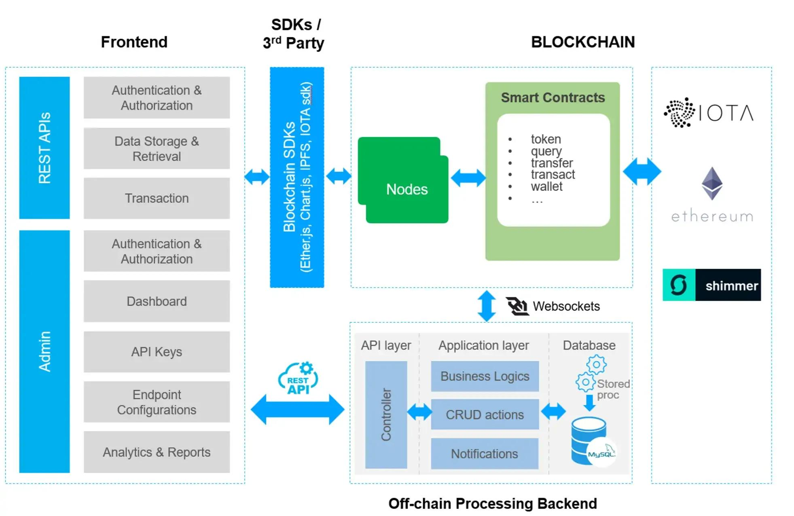
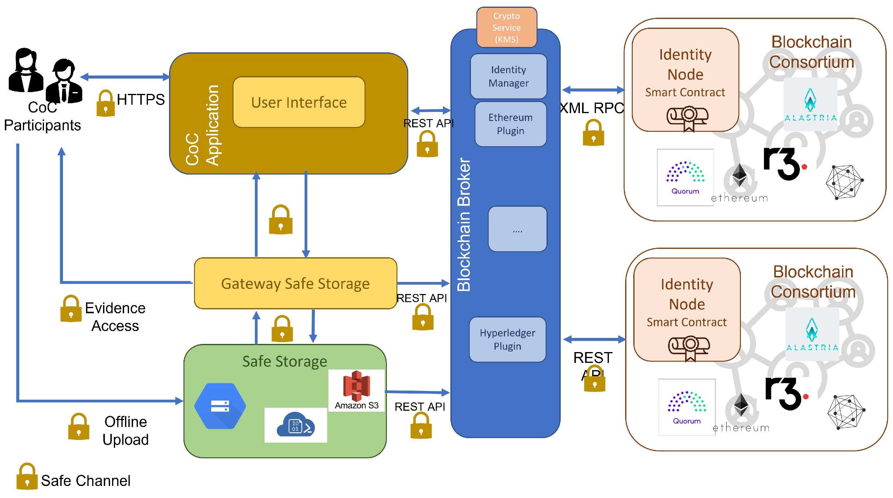
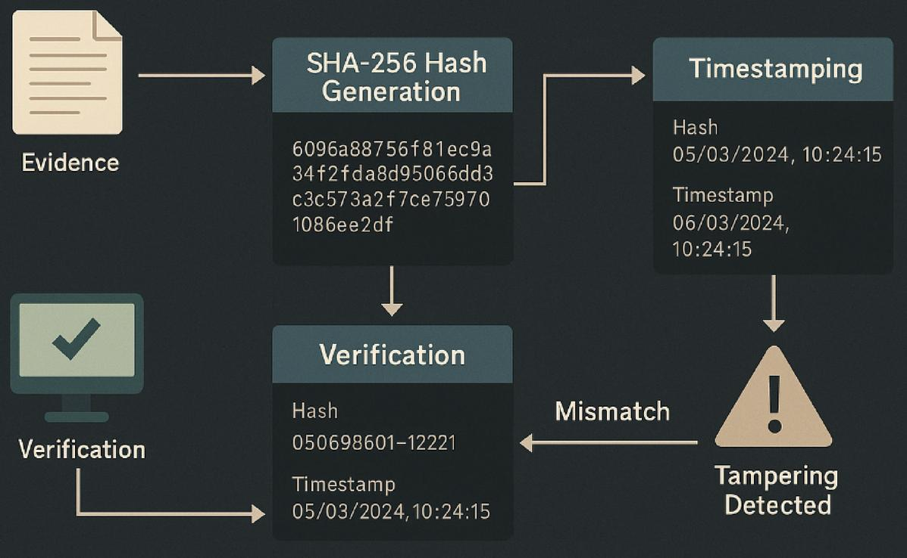
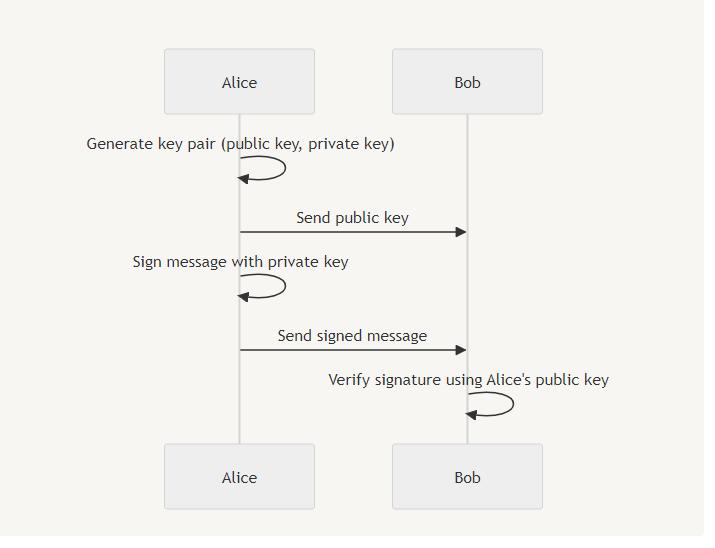
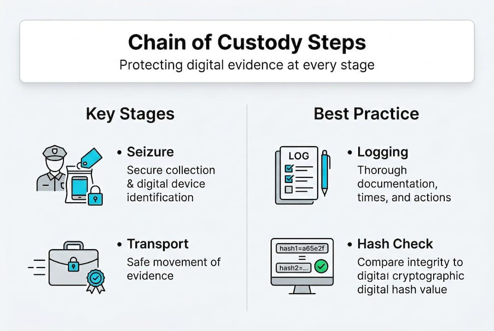

# BEI-2026 – Blockchain-Based Digital Evidence Integrity

## 1. Giới thiệu

BEI-2026 là dự án nghiên cứu và thử nghiệm ứng dụng công nghệ Blockchain nhằm hỗ trợ đảm bảo tính toàn vẹn của chứng cứ số.

Dự án kết hợp các công nghệ:

- **SHA-256:** Tạo dấu vân tay số của chứng cứ.
- **Ed25519:** Ký và xác minh metadata.
- **Solidity Smart Contract:** Đăng ký và xác minh hash chứng cứ trên Blockchain.
- **Chain of Custody:** Ghi nhận quá trình bàn giao và lịch sử quản lý chứng cứ.
- **Python và TypeScript:** Xây dựng công cụ xử lý và tích hợp hệ thống.

Dự án được triển khai trong môi trường Kali Linux và mạng Blockchain local của Hardhat, phục vụ mục đích học tập, nghiên cứu và trình diễn.

## 2. Mục tiêu dự án

1. Tính toán giá trị SHA-256 của file chứng cứ.
2. Phát hiện sự thay đổi dữ liệu thông qua đối chiếu hash.
3. Sử dụng Ed25519 để ký và xác minh metadata chứng cứ.
4. Đăng ký hash chứng cứ lên Smart Contract.
5. Xác minh tính toàn vẹn của chứng cứ với dữ liệu trên Blockchain.
6. Ghi nhận và truy vấn lịch sử bàn giao chứng cứ.
7. Kiểm thử các trường hợp hợp lệ và không hợp lệ.

## 3. Kiến trúc tổng quan

```text
             DIGITAL EVIDENCE
                    |
                    v
             PYTHON SHA-256
                    |
                    v
             ED25519 SIGNATURE
                    |
                    v
       PYTHON - TYPESCRIPT INTEGRATION
                    |
                    v
            LOCAL BLOCKCHAIN
               (HARDHAT)
                    |
                    v
         EVIDENCE REGISTRY CONTRACT
                    |
          +---------+---------+
          |                   |
          v                   v
    HASH VERIFICATION   CHAIN OF CUSTODY
                              |
                              v
                       EVENT HISTORY
```

### Nguyên tắc thiết kế

- File chứng cứ được lưu trữ ngoài Blockchain.
- Blockchain lưu hash và các metadata cần thiết.
- Private key không được đưa lên Blockchain hoặc Git.
- Lịch sử bàn giao được truy xuất từ các sự kiện của Smart Contract.
- Mỗi chứng cứ được quản lý bằng một Evidence ID riêng biệt.

## 4. Project Diagrams

Các sơ đồ dưới đây mô tả kiến trúc, quy trình xử lý và những chức năng chính của BEI-2026.

### 4.1. System Architecture



Mô tả kiến trúc tổng thể và mối quan hệ giữa các thành phần Python, Smart Contract, Blockchain và bộ lưu trữ chứng cứ off-chain.

### 4.2. Evidence Registration



Mô tả quy trình lựa chọn chứng cứ, tính toán SHA-256, chuẩn bị metadata và đăng ký thông tin chứng cứ lên Blockchain.

### 4.3. Integrity Verification



Mô tả quy trình tính toán lại hash và đối chiếu với hash đã đăng ký nhằm phát hiện sự thay đổi nội dung chứng cứ.

### 4.4. Digital Signature



Mô tả cơ chế ký và xác minh chữ ký số Ed25519 bằng private key và public key.

### 4.5. Chain of Custody



Mô tả quá trình đăng ký chứng cứ, khởi tạo bàn giao, chấp nhận bàn giao và truy xuất lịch sử quản lý chứng cứ.

### 4.6. System Workflow


Mô tả toàn bộ vòng đời xử lý chứng cứ từ khi tiếp nhận đến khi xác minh tính toàn vẹn và quản lý bàn giao.

## 5. Documentation

Tài liệu kỹ thuật chi tiết được phân chia theo từng thành phần của hệ thống.

| Tài liệu | Nội dung |
|---|---|
| [System Architecture](docs/architecture.md) | Kiến trúc tổng thể và các thành phần hệ thống |
| [System Workflow](docs/system_workflow.md) | Quy trình hoạt động tổng thể |
| [Evidence Registration](docs/evidence_registration.md) | Quy trình đăng ký chứng cứ |
| [Integrity Verification](docs/integrity_verification.md) | Quy trình xác minh tính toàn vẹn |
| [Digital Signature](docs/digital_signature.md) | Cơ chế chữ ký số Ed25519 |
| [Chain of Custody](docs/chain_of_custody.md) | Quản lý và truy xuất lịch sử bàn giao |

## 6. Công nghệ sử dụng

| Thành phần | Công nghệ |
|---|---|
| Operating System | Kali Linux |
| Smart Contract | Solidity 0.8.34 |
| Blockchain Framework | Hardhat 3 |
| Blockchain Interaction | Ethers.js 6 |
| Programming Language | Python 3 |
| Digital Signature | Ed25519 |
| Hash Algorithm | SHA-256 |
| TypeScript | TypeScript 6 |

## 7. Cấu trúc dự án

```text
Blockchain_Evidence_Integrity/
├── contracts/
│   └── EvidenceRegistry.sol
├── docs/
│   ├── architecture.md
│   ├── system_workflow.md
│   ├── evidence_registration.md
│   ├── integrity_verification.md
│   ├── digital_signature.md
│   └── chain_of_custody.md
├── evidence_samples/
├── img/
│   ├── architecture.png
│   ├── evidence_registration.png
│   ├── integrity_verification.png
│   ├── digital_signature.png
│   ├── chain_of_custody.png
│   └── system_workflow.png
├── keys/
├── python/
│   ├── hash_evidence.py
│   └── digital_signature.py
├── report/
├── results/
├── scripts/
│   ├── deploy_coc.ts
│   ├── custody.ts
│   ├── custody_history.ts
│   └── integrate_evidence.ts
├── test/
├── screenshots/
├── README.md
├── hardhat.config.ts
└── package.json
```

## 8. Cài đặt môi trường

### Yêu cầu

- Kali Linux hoặc hệ điều hành Linux tương thích.
- Node.js.
- npm.
- Python 3.
- Git.
- Các thư viện Python cần thiết.

### Cài đặt dependency

Cài đặt các package Node.js:

```bash
npm install
```

Cài đặt thư viện Python:

```bash
python3 -m pip install cryptography
```

Kiểm tra phiên bản:

```bash
node --version
npm --version
python3 --version
npx hardhat --version
```

## 9. Tính toán và xác minh SHA-256

### 9.1. Tính toán hash

```bash
python3 python/hash_evidence.py hash evidence_samples/evidence_001.txt
```

Chương trình sẽ đọc file và tính toán giá trị SHA-256.

### 9.2. Xác minh tính toàn vẹn

```bash
python3 python/hash_evidence.py verify evidence_samples/evidence_001.txt --expected <EXPECTED_SHA256>
```

Thay `<EXPECTED_SHA256>` bằng giá trị hash đã ghi nhận trước đó.

Nếu hash trùng khớp, file được xác nhận không thay đổi so với giá trị tham chiếu. Nếu không trùng khớp, chương trình phát hiện sự sai khác.

## 10. Chữ ký số Ed25519

### 10.1. Tạo cặp khóa

```bash
python3 python/digital_signature.py generate-keys \
  --private-key keys/private_key.pem \
  --public-key keys/public_key.pem
```

Chương trình tạo một cặp khóa Ed25519 gồm khóa riêng tư và khóa công khai.

Không sử dụng tùy chọn `--force` nếu không có chủ đích ghi đè khóa hiện có.

### 10.2. Ký metadata chứng cứ

```bash
python3 python/digital_signature.py sign evidence_samples/evidence_001.txt \
  --evidence-id BEI-EV-001 \
  --private-key keys/private_key.pem \
  --output results/evidence_001.signature.json
```

Chương trình tạo chữ ký số cho metadata của chứng cứ.

### 10.3. Xác minh chữ ký

```bash
python3 python/digital_signature.py verify evidence_samples/evidence_001.txt \
  --manifest results/evidence_001.signature.json \
  --public-key keys/public_key.pem
```

Quá trình xác minh kiểm tra sự tương ứng giữa file chứng cứ, metadata và chữ ký số.

## 11. Smart Contract và Blockchain local

### 11.1. Biên dịch Smart Contract

```bash
npx hardhat compile
```

### 11.2. Kiểm thử Smart Contract

```bash
npx hardhat test
```

### 11.3. Khởi chạy Blockchain local

Mở Terminal 1:

```bash
npx hardhat node --network hardhatMainnet
```

Giữ Terminal 1 hoạt động trong suốt quá trình triển khai và demo.

Blockchain local được sử dụng để mô phỏng môi trường giao dịch và lưu trữ dữ liệu chứng cứ.

## 12. Triển khai và tích hợp chứng cứ

Mở Terminal 2 tại thư mục dự án.

### 12.1. Deploy Smart Contract

```bash
npx hardhat run scripts/deploy_coc.ts --network localhost
```

Thông tin triển khai được lưu trong thư mục `results/`.

### 12.2. Tích hợp chứng cứ

```bash
npx hardhat run scripts/integrate_evidence.ts --network localhost
```

Quy trình tích hợp:

1. Python tính toán SHA-256.
2. Python xác minh chữ ký Ed25519.
3. TypeScript kiểm tra cấu hình Blockchain.
4. Kiểm tra Evidence ID đã tồn tại hay chưa.
5. Gửi giao dịch đăng ký hash lên Smart Contract.
6. Đọc lại dữ liệu từ Blockchain.
7. Đối chiếu hash giữa Python và Blockchain.

Hệ thống có cơ chế từ chối đăng ký trùng Evidence ID.

## 13. Chain of Custody

Chức năng Chain of Custody hỗ trợ ghi nhận quá trình bàn giao chứng cứ.

Các chức năng chính:

- `handoverEvidence`: Khởi tạo yêu cầu bàn giao.
- `acceptHandover`: Chấp nhận bàn giao.
- `cancelHandover`: Hủy yêu cầu bàn giao.
- `getCustody`: Truy vấn trạng thái người quản lý hiện tại.

Chạy thử nghiệm bàn giao:

```bash
npx hardhat run scripts/custody.ts --network localhost
```

Truy vấn lịch sử sự kiện:

```bash
npx hardhat run scripts/custody_history.ts --network localhost
```

Lịch sử được tái dựng từ các sự kiện Blockchain, bao gồm đăng ký chứng cứ và các lần bàn giao.

## 14. Kiểm thử và đánh giá

### 14.1. Kiểm tra TypeScript

```bash
npx tsc --noEmit
```

### 14.2. Chạy toàn bộ kiểm thử

```bash
npx hardhat test
```

Kết quả tại thời điểm hoàn thành giai đoạn kiểm thử:

**22 tests passing.**

### 14.3. Các nhóm kiểm thử

- SHA-256 hashing.
- SHA-256 integrity verification.
- Ed25519 signature generation.
- Ed25519 signature verification.
- Modified evidence detection.
- Tampered signature detection.
- Smart Contract registration.
- Smart Contract verification.
- Duplicate evidence registration.
- Chain of Custody handover.
- Python–Blockchain integration.

Chi tiết kết quả được lưu tại:

- `results/security_test_report.md`
- `results/integration_report.md`
- `results/deployment_coc_verification.md`
- `results/execution_log.md`

## 15. Dữ liệu chứng cứ thử nghiệm

Dự án sử dụng dữ liệu giả lập trong thư mục `evidence_samples/`.

| File | Mục đích |
|---|---|
| evidence_001.txt | Chứng cứ mẫu ban đầu |
| evidence_001_modified.txt | Chứng cứ đã bị thay đổi |
| evidence_002_large.bin | Kiểm thử file nhị phân dung lượng lớn |

Các file được sử dụng để đánh giá khả năng tính toán hash, phát hiện thay đổi và xác minh tính toàn vẹn.

Không sử dụng dữ liệu cá nhân hoặc chứng cứ thật trong môi trường demo.

## 16. Bảo mật và giới hạn

### 16.1. Bảo mật

- Private key phải được bảo vệ và không được commit lên Git.
- File chứng cứ được lưu trữ ngoài Blockchain.
- Không đưa dữ liệu nhạy cảm lên mạng Blockchain công khai.
- Sử dụng dữ liệu giả lập trong quá trình kiểm thử.
- Các giao dịch được thực hiện trong mạng Blockchain local.

### 16.2. Giới hạn

- SHA-256 chỉ giúp phát hiện sự thay đổi nội dung khi đối chiếu với hash tham chiếu, không tự chứng minh nguồn gốc hoặc tính xác thực pháp lý.
- Ed25519 xác minh chữ ký bằng khóa công khai tương ứng, không tự xác nhận danh tính ngoài đời thực của người ký.
- Blockchain local chỉ phục vụ thử nghiệm, không đại diện cho hệ thống production.
- Dự án chưa tích hợp CA, HSM, trusted timestamp hoặc quy trình quản lý vòng đời khóa hoàn chỉnh.
- Smart Contract không thể tự chứng minh chứng cứ được thu thập đúng quy trình pháp chứng.
- Địa chỉ ví chỉ đại diện cho tài khoản Blockchain, không đồng nghĩa với danh tính pháp lý.

## 17. Phạm vi sử dụng

BEI-2026 được xây dựng phục vụ mục đích học tập, nghiên cứu và trình diễn ứng dụng Blockchain trong đảm bảo tính toàn vẹn của chứng cứ số.

Dự án chưa được thiết kế để thay thế các quy trình pháp chứng chuyên nghiệp hoặc được sử dụng như căn cứ duy nhất để kết luận giá trị pháp lý của chứng cứ.

---

**Project:** BEI-2026  
**Topic:** Blockchain-Based Digital Evidence Integrity  
**Environment:** Kali Linux / Hardhat Local Network  
**Purpose:** Academic Research and Demonstration
