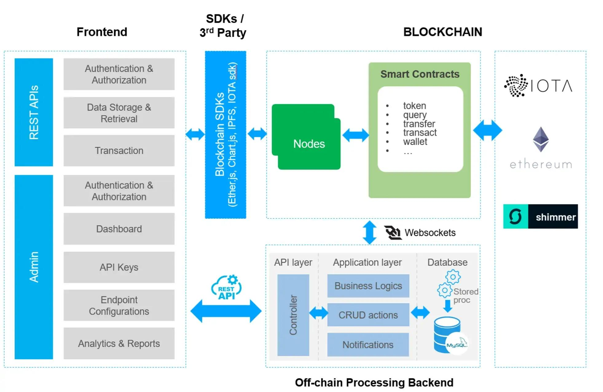

# System Architecture

## 1. Overview

The Blockchain-Based Digital Evidence Integrity system is designed to support the integrity verification and traceability of digital evidence.

The system combines Python-based evidence processing, SHA-256 hashing, Ed25519 digital signatures, ethers.js, Solidity Smart Contracts, and a local blockchain network.

## 2. Main Components

| Component | Responsibility |
|---|---|
| User / Investigator | Selects and manages digital evidence |
| Python Processing | Processes evidence files and generates SHA-256 hashes |
| Digital Signature Module | Creates and verifies Ed25519 digital signatures |
| ethers.js | Connects application scripts to the blockchain |
| EvidenceRegistry.sol | Handles evidence registration and related records |
| Hardhat Blockchain | Stores transactions and on-chain evidence records |
| Off-chain Storage | Stores the original evidence files |

## 3. System Architecture Layers

### 3.1 Application Layer

The investigator interacts with the system to select evidence files and perform operations such as registration and integrity verification.

### 3.2 Processing Layer

Python scripts perform evidence processing, including:

- Generating SHA-256 hashes.
- Creating digital signatures.
- Verifying digital signatures.
- Comparing evidence hashes.

### 3.3 Smart Contract Layer

The `EvidenceRegistry.sol` smart contract manages evidence records and Chain of Custody operations.

### 3.4 Blockchain Layer

The Hardhat local blockchain provides the environment for recording transactions and maintaining on-chain data.

## 4. Data Storage Model

The system uses a combination of on-chain and off-chain storage.

**Off-chain:**
- Original digital evidence files.
- Supporting files and related materials.

**On-chain:**
- Evidence identifiers.
- Evidence hashes.
- Relevant metadata.
- Transaction history and Chain of Custody records.

This approach avoids storing entire evidence files directly on the blockchain.

## 5. Design Considerations

- SHA-256 is used to detect changes in evidence content.
- Ed25519 supports digital signing and signature verification.
- Smart Contracts manage evidence records and custody operations.
- Original evidence files remain off-chain.
- Blockchain transactions provide traceable records of system operations.

## 6. Limitations

The current implementation uses a local Hardhat blockchain for demonstration and testing.

Blockchain records and digital signatures do not independently prove the original authenticity of evidence or establish the real-world identity of the person holding a private key.