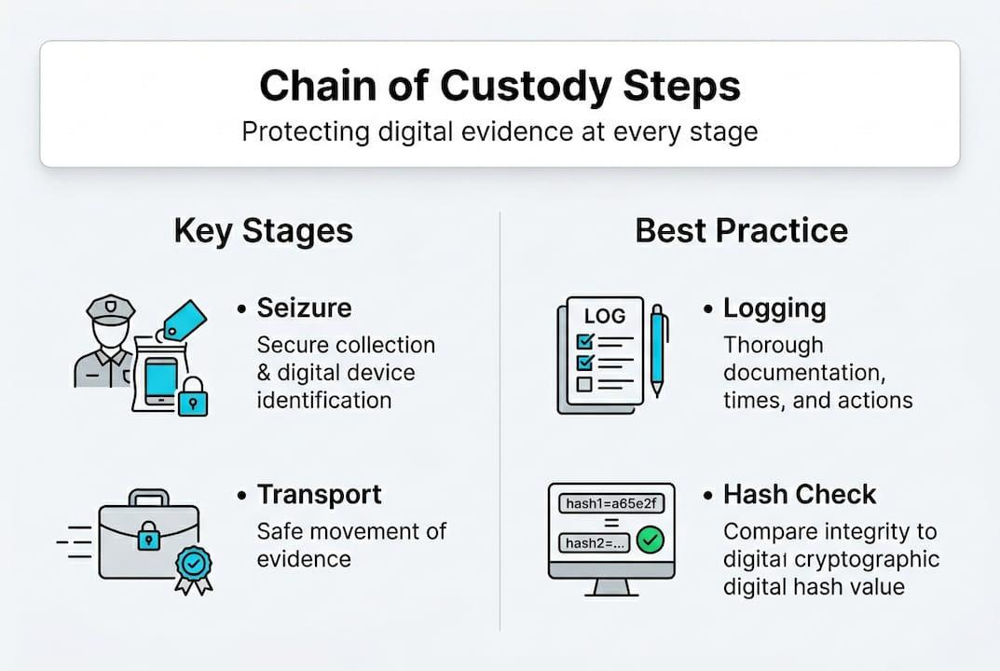

# Chain of Custody

## 1. Overview

Chain of Custody is the process of recording and tracking the handling and transfer of digital evidence.

In this project, the smart contract supports recording evidence handover activities on the blockchain.

These records help provide a traceable history of custody-related operations.

## 2. Main Components

| Component | Responsibility |
|---|---|
| Evidence ID | Identifies the registered evidence |
| Current Custodian | Represents the current evidence custodian |
| Sender | Initiates an evidence handover |
| Recipient | Receives the handover request |
| Smart Contract | Processes and records custody operations |
| Blockchain | Maintains transaction records |

## 3. Chain of Custody Workflow

### Step 1: Evidence Registration

Evidence is registered on the blockchain before custody operations are performed.

### Step 2: Handover Initiation

The current custodian initiates a handover request to another recipient.

### Step 3: Handover Acceptance

The recipient accepts the handover request through the smart contract.

### Step 4: Record Update

The smart contract updates the custody information according to the implemented rules.

### Step 5: History Review

The system can retrieve relevant blockchain records to review previous custody operations.

## 4. Expected Results

The Chain of Custody mechanism supports:

- Recording handover requests.
- Recording handover acceptance.
- Tracking custody-related transactions.
- Reviewing evidence handover history.

## 5. Security Considerations

- Only authorized addresses should perform permitted operations.
- Handover requests should be checked before acceptance.
- Blockchain transactions provide traceable records of submitted operations.
- Wallet addresses do not independently establish the real-world identity of their owners.

## 6. Limitations

The current implementation demonstrates Chain of Custody operations on a local Hardhat blockchain.

It does not replace formal forensic procedures, identity verification, evidence preservation policies, or legal requirements.