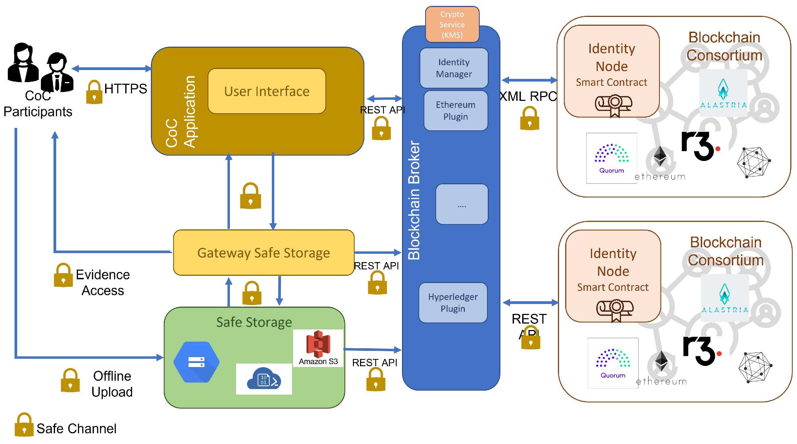

# Evidence Registration

## 1. Overview

Evidence Registration is the process of creating an on-chain record for digital evidence.

Instead of storing the original evidence file directly on the blockchain, the system generates a SHA-256 hash and records relevant evidence information through the `EvidenceRegistry.sol` smart contract.

## 2. Registration Process

### Step 1: Evidence Selection

The investigator selects a digital evidence file for registration.

### Step 2: Hash Generation

The system calculates the SHA-256 hash of the selected file.

The hash represents the file's content at the time of processing.

### Step 3: Metadata Preparation

Relevant information is prepared for registration, such as:

- Evidence ID.
- Evidence hash.
- Evidence description.
- Related metadata supported by the smart contract.

### Step 4: Blockchain Transaction

The application uses ethers.js to interact with the `EvidenceRegistry.sol` smart contract.

The registration request is submitted as a blockchain transaction.

### Step 5: Transaction Confirmation

After successful execution, the blockchain records the transaction and the corresponding evidence information.

### Step 6: Evidence Identification

The registered evidence can be referenced through its Evidence ID and associated blockchain record.

## 3. Data Storage

**Off-chain:**
- Original evidence file.
- Additional supporting materials.

**On-chain:**
- Evidence ID.
- SHA-256 hash.
- Relevant registration information.

## 4. Expected Result

Successful registration provides an on-chain reference that can later be used for evidence integrity verification.

## 5. Security Considerations

- The original evidence file should be preserved.
- Private keys must not be exposed.
- Evidence metadata should be checked before registration.
- A successful blockchain transaction does not independently prove that the submitted evidence was authentic before registration.