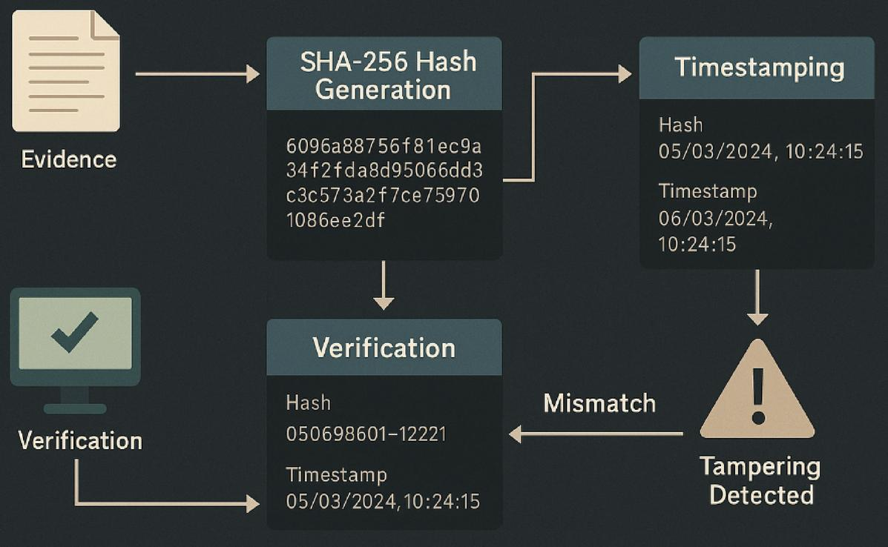
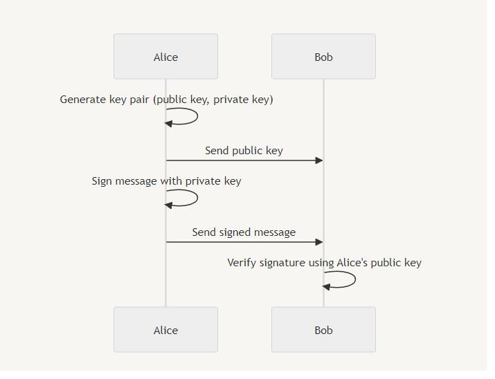

# Evidence Integrity Verification



## 1. Overview

Evidence Integrity Verification is the process of checking whether a digital evidence file has changed after its hash was registered on the blockchain.

The system uses SHA-256 to calculate the current file hash and compares it with the previously registered hash.

## 2. Verification Process

### Step 1: Evidence Selection

The investigator selects the evidence file that needs to be verified.

### Step 2: Current Hash Generation

The system calculates a new SHA-256 hash from the selected file.

### Step 3: Retrieve Registered Hash

The application retrieves the corresponding evidence record from the blockchain through the smart contract.

### Step 4: Hash Comparison

The system compares:

- Current SHA-256 hash.
- Previously registered SHA-256 hash.

### Step 5: Verification Result

The system evaluates the comparison result.

**If the hashes match:**

The file content is consistent with the content represented by the registered hash.

**If the hashes do not match:**

The file content differs from the content represented by the registered hash.

## 3. Verification Logic

Conceptually:

```python
if current_hash == registered_hash:
    print("Integrity verified")
else:
    print("Integrity mismatch")
	```

## 4. Expected Results
| Condition | Result |
| :--- | :--- |
| Current hash matches registered hash | Integrity verified |
| Current hash differs from registered hash | Integrity mismatch |
| Evidence record does not exist | Verification cannot be completed |

## 5. Security Considerations
- SHA-256 provides a way to detect changes in file content.
- However, a matching hash only indicates consistency with the registered hash. It does not independently prove the origin, accuracy, or legal authenticity of the evidence.


## 5. `docs/digital_signature.md`

# Digital Signature



## 1. Overview

The system uses the Ed25519 digital signature algorithm to support data signing and signature verification.

Digital signatures help verify whether signed data has been modified and whether the signature corresponds to the public key used for verification.

## 2. Key Components

| Component | Description |
|---|---|
| Private Key | Used to create a digital signature |
| Public Key | Used to verify a digital signature |
| Data | The content being signed |
| Signature | The result generated by the signing process |

## 3. Digital Signature Process

### 3.1 Signing

1. Prepare the data to be signed.
2. Load the authorized Ed25519 private key.
3. Generate a digital signature.
4. Store or transmit the signature together with the relevant data.

### 3.2 Verification

1. Retrieve the original signed data.
2. Retrieve the corresponding digital signature.
3. Load the corresponding Ed25519 public key.
4. Verify the signature.
5. Return the verification result.

## 4. Verification Results

| Condition | Result |
|---|---|
| Valid signature and unchanged data | Verification successful |
| Data has been modified | Verification failed |
| Invalid signature | Verification failed |
| Incorrect public key | Verification failed |

## 5. Security Considerations

- Private keys must be protected and never published.
- Public keys can be distributed for signature verification.
- A public key must be reliably associated with its owner's identity when identity verification is required.
- A valid signature does not independently prove that the signed information is factually correct.

## 6. Role in the Project

Ed25519 provides an additional verification mechanism alongside SHA-256 and blockchain-based evidence registration.

It supports the verification of signed data and helps protect the integrity of the signing process.
