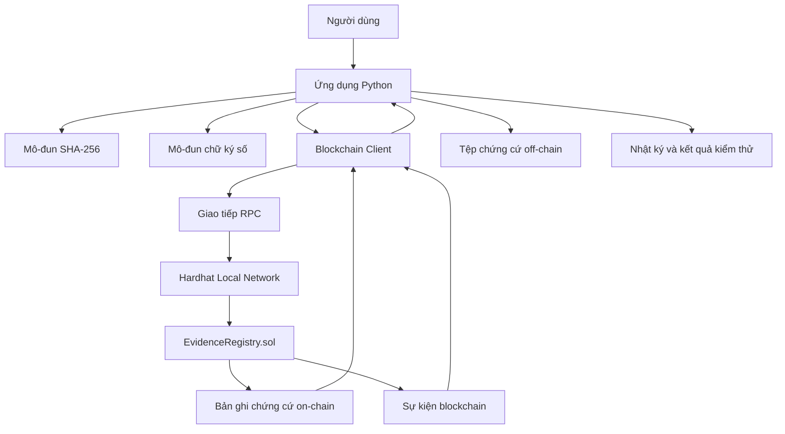
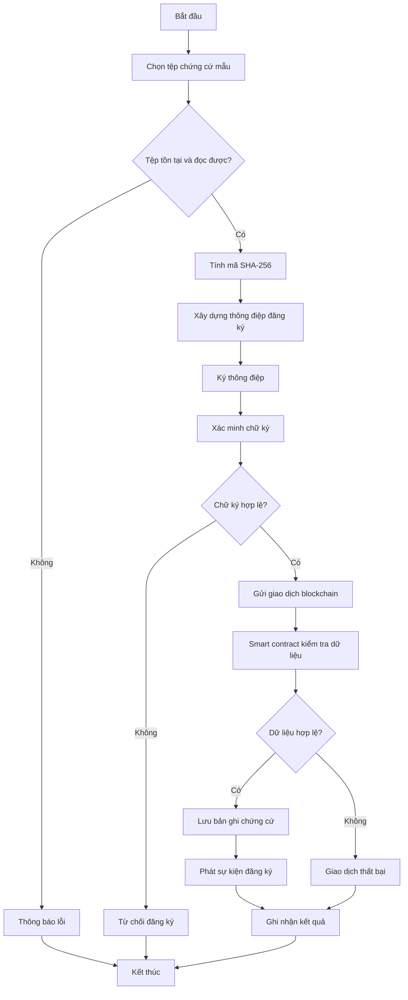
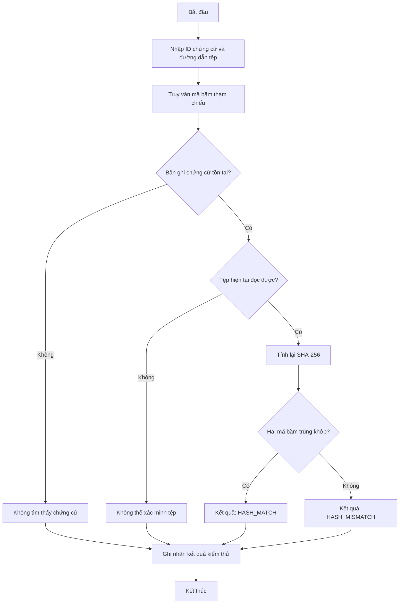
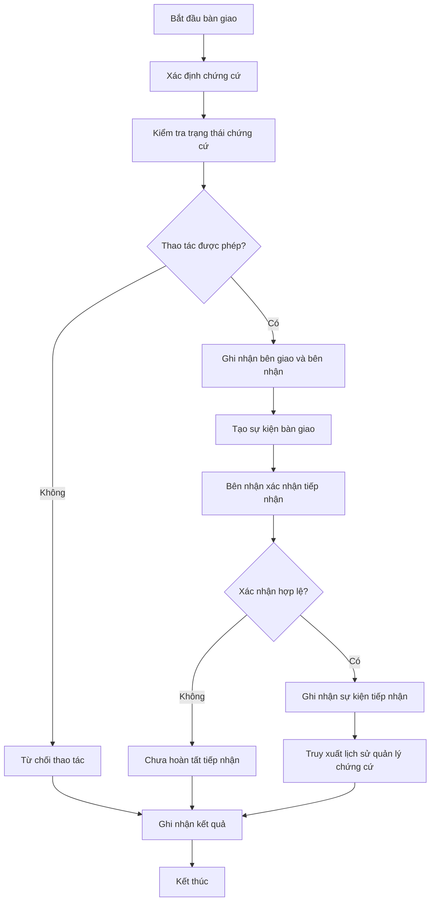

# SƠ ĐỒ KIẾN TRÚC VÀ LUỒNG XỬ LÝ

**Tên dự án:** Blockchain-Based Digital Evidence Integrity
**Mã dự án:** BEI-2026
**Phiên bản:** 0.1
**Trạng thái:** Thiết kế ban đầu

---

## 1. Sơ đồ kiến trúc tổng thể

**Giải thích:**

- Ứng dụng Python điều phối các thao tác xử lý chứng cứ.
- Mô-đun SHA-256 tạo mã băm để nhận diện nội dung tệp.
- Mô-đun chữ ký số hỗ trợ ký và xác minh thông điệp.
- Blockchain Client giao tiếp với mạng blockchain cục bộ.
- Smart contract quản lý bản ghi và phát sự kiện.
- Tệp chứng cứ và nhật ký được lưu ngoài blockchain.

---

## 2. Sơ đồ đăng ký chứng cứ

**Giải thích:**

Hệ thống chỉ gửi giao dịch sau khi thực hiện các bước kiểm tra cần thiết. Smart contract tiếp tục kiểm tra dữ liệu theo những quy tắc được lập trình.

Giao dịch được gửi không đồng nghĩa với việc đăng ký đã thành công. Chương trình phải kiểm tra kết quả thực thi giao dịch và trạng thái bản ghi.

---

## 3. Sơ đồ xác minh tính toàn vẹn

**Giải thích:**

- `HASH_MATCH`: mã băm hiện tại trùng với mã băm tham chiếu.
- `HASH_MISMATCH`: mã băm hiện tại khác với mã băm tham chiếu.
- Không tìm thấy bản ghi hoặc không đọc được tệp là các tình huống riêng, không được đánh đồng với kết quả mã băm không khớp.

Mã băm trùng khớp cho thấy nội dung tệp phù hợp với giá trị tham chiếu đã đăng ký; điều đó không tự chứng minh nguồn gốc hoặc tính xác thực ban đầu của chứng cứ.

---

## 4. Sơ đồ bàn giao và tiếp nhận chứng cứ

**Giải thích:**

Chuỗi quản lý chứng cứ (Chain of Custody) ghi lại các sự kiện bàn giao và tiếp nhận theo trình tự. Mô hình thử nghiệm ghi nhận tài khoản blockchain và sự kiện liên quan; nó không tự xác minh danh tính thật của người giao hoặc người nhận.

---

## 5. Phân tách dữ liệu on-chain và off-chain

| Dữ liệu | Vị trí lưu trữ dự kiến | Mục đích |
|---|---|---|
| Tệp chứng cứ mẫu | Off-chain | Lưu nội dung cần kiểm tra |
| Mã SHA-256 | On-chain và kết quả cục bộ | Đối chiếu tính toàn vẹn |
| Mã định danh chứng cứ | On-chain | Truy xuất bản ghi |
| Thông tin đăng ký tối thiểu | On-chain | Theo dõi bản ghi |
| Sự kiện bàn giao, tiếp nhận | On-chain | Kiểm tra lịch sử |
| Khóa riêng | Lưu riêng ngoài blockchain | Ký thông điệp |
| Nhật ký thực thi | Off-chain | Theo dõi quá trình triển khai |
| Kết quả kiểm thử | Off-chain | Đánh giá các ca kiểm thử |
| Báo cáo và ảnh minh chứng | Off-chain | Hoàn thiện hồ sơ dự án |

---

## 6. Ghi chú triển khai

1. Các sơ đồ thể hiện thiết kế dự kiến, chưa phải bằng chứng rằng tất cả chức năng đã được triển khai.
2. Tên hàm, cấu trúc dữ liệu và sự kiện phải được cập nhật theo mã nguồn thực tế.
3. Không lưu khóa riêng hoặc dữ liệu chứng cứ nhạy cảm trên blockchain.
4. Chỉ sử dụng dữ liệu mẫu không nhạy cảm trong quá trình phát triển và kiểm thử.
5. Chỉ đánh dấu một chức năng hoàn thành sau khi đã có mã nguồn và kết quả kiểm thử tương ứng.

---

## 7. Trạng thái

Phiên bản: 0.1.

Trạng thái: Đang thiết kế.

Kết quả nghiệm thu sẽ được cập nhật sau khi kiểm tra tài liệu và đối chiếu với quá trình triển khai.
